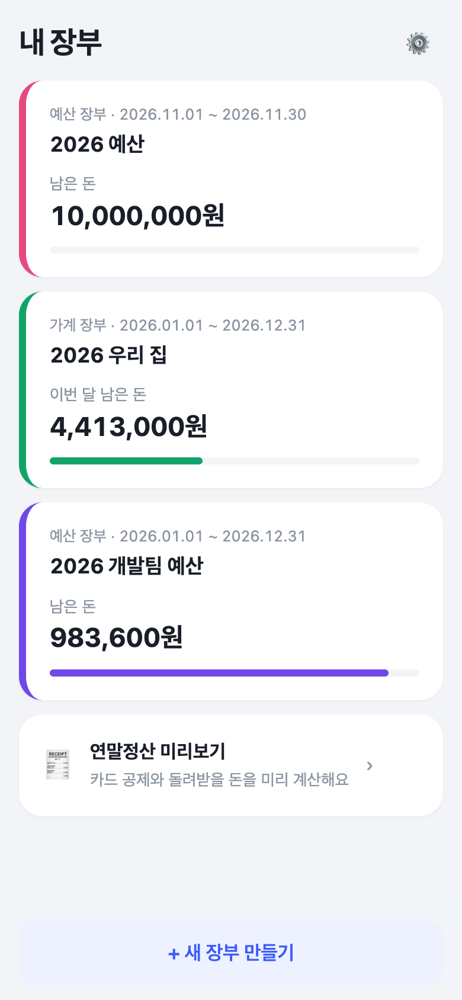
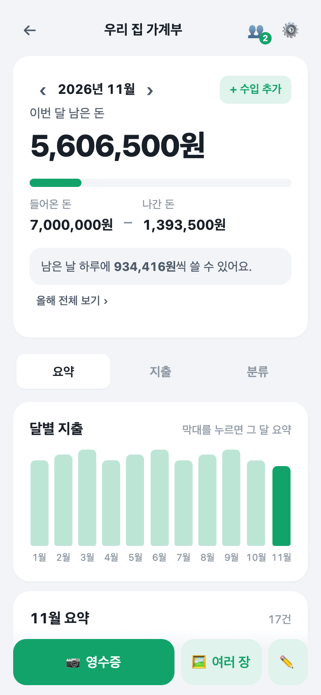
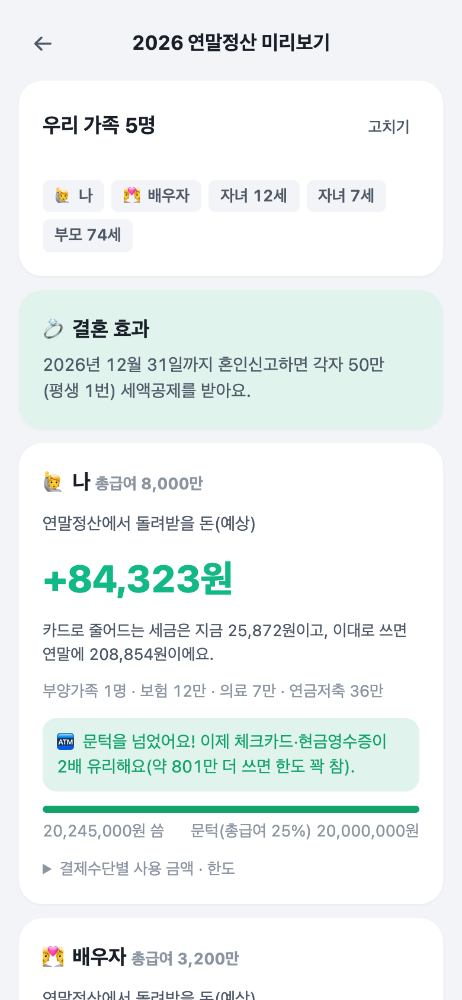

# 💰 Jaeseo · 재서

[한국어](README.md) · **English**

A personal finance assistant that makes money management easy, starting with a receipt. It tracks team/project budgets and household spending, and previews how much each spouse will get back at Korean year-end tax settlement.

▶ **Try it: [jaeseo.lunchtime.workers.dev](https://jaeseo.lunchtime.workers.dev)** (sign up and start · designed for phones · Korean UI)

> This repository is a showcase. The service source code is kept private.

  
  
  
  
  

## About

**Two kinds of ledgers**
- **Budget ledger**: team, project or yearly budgets. Set budgets per category (amount or %), and it shows what's left and when you'll run out at the current pace. Invite teammates; every expense shows who added it.
- **Household ledger**: family living costs. Add income such as salary and bonuses to see money in − money out for each month, and record who paid (me/spouse).

**As little typing as possible**
- 📷 Take a photo of a receipt and the amount, date, store and payment method are filled in. Photos are read on the device and never uploaded.
- 🖼️ Pick many receipt photos from the gallery at once, or import a card company statement (.xlsx, .csv, .xls).
- Categories are guessed from store names (pharmacy → medical, taxi → transport), and corrections are remembered per store.

**Taxes (Korean rules, 2026)**
- **Year-end settlement preview**: from both spouses' salaries and the family (children, parents), it estimates each person's refund, how far they are from the card-deduction threshold (25% of salary), and tips like "debit cards pay off more from here". Insurance, medical, education, pension savings and rent credits are included.
- **Couples**: before/after marriage registration, the marriage tax credit, and whose card to concentrate spending on.
- **May income tax filing**: side jobs, freelance and other income are calculated separately.
- **Business spending**: account titles and evidence types, VAT to reclaim, warnings for entertainment expenses without proper evidence, and withholding on labor costs (3.3%, 8.8%, daily workers).

**Also**
- 💳 Monthly spending targets across several cards, with a "use this card next" suggestion
- 📊 Excel export (all ledgers or one ledger) and restore from that file
- Sharing and unsharing ledgers, merging ledgers after marriage

## How it's built

| Area | Details |
|---|---|
| Front end | TypeScript · Vite, no framework, small screen modules · mobile first · light/dark |
| Server | Cloudflare Workers + Hono · Zod validation · Cloudflare D1 (SQLite) |
| OCR | Tesseract.js (Korean + English) running in the browser |
| Excel | read-excel-file · write-excel-file (read and written in the browser) |
| Tests | Vitest — 109 unit tests for calculations · 33 API tests against a running server · Playwright checks |

**Design notes**
- **Tax math as pure functions**: all 2026 tax figures live in one file, checked against the original statutes and pinned by tests. When the law changes, only that file changes.
- **Integer won arithmetic**: amounts and rates are computed as integers to avoid floating-point errors.
- **Privacy**: receipt images are never stored. Health information (disability, medical costs) is stored only with separate consent, and everything is deleted immediately on account deletion.
- **Security**: PBKDF2 password hashing, login and sign-up rate limits, a Content Security Policy, CSRF protection, and server-side membership checks on every ledger.
- **Fits the free tier**: hundreds of imported rows go into the database in a single batch (the platform allows 50 queries per request).

## Note

Tax figures are estimates. Jaeseo is not tax advice or a filing service; please confirm with Hometax or a tax accountant before filing.
