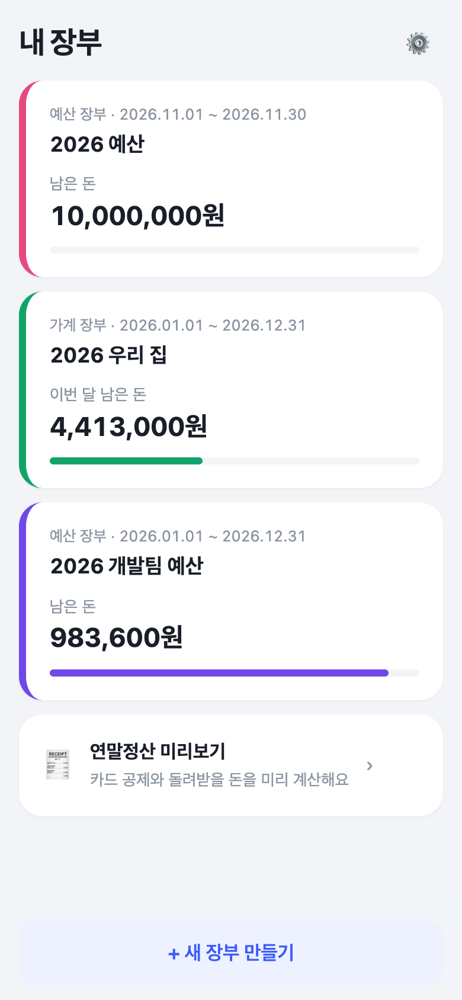
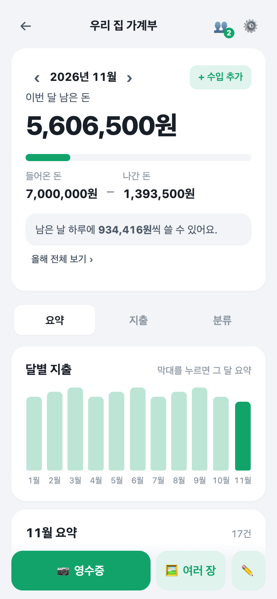
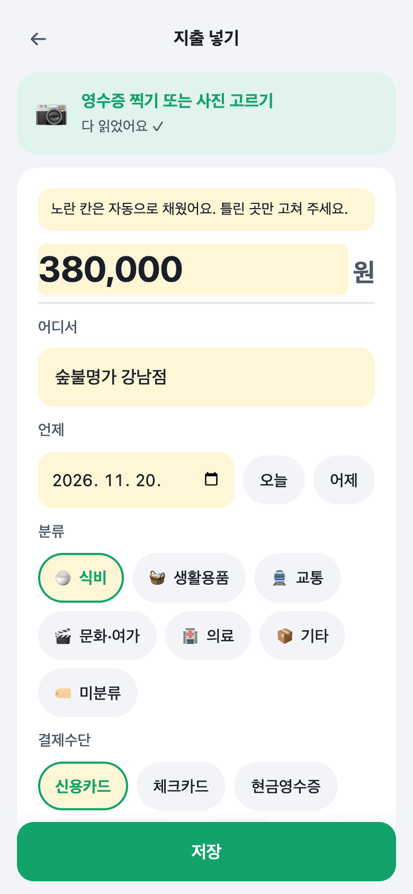
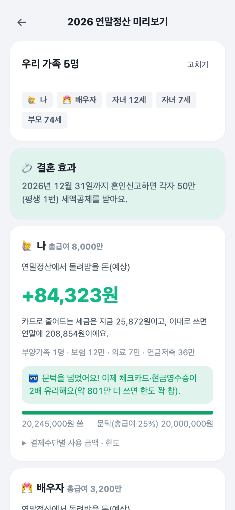
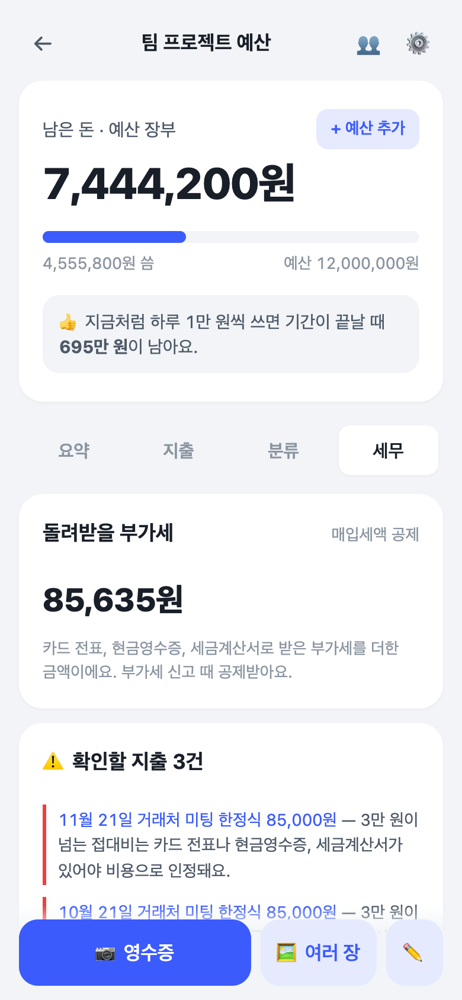

# 💰 재서 · Jaeseo

**한국어** · [English](README.en.md)

영수증으로 가볍게 시작하는 돈 관리, 재무 비서 재서. 팀·프로젝트 예산과 우리 집 생활비를 관리하고, 연말정산 때 부부가 각자 얼마나 돌려받을지 미리 계산해 줍니다.

▶ **써 보기: [jaeseo.lunchtime.workers.dev](https://jaeseo.lunchtime.workers.dev)** (가입 후 바로 사용 · 휴대폰 화면 기준)

> 이 저장소는 소개용입니다. 서비스 코드는 비공개로 관리합니다.

  
  
  
  
  

## 소개

**장부 두 가지**
- **예산 장부**: 팀·프로젝트·연간 예산. 분류별 예산(금액 또는 %)을 정하면 남은 돈과 「이 속도면 언제 바닥나는지」를 알려 줍니다. 팀원을 초대해 함께 쓰고, 지출마다 넣은 사람이 보입니다.
- **가계 장부**: 우리 집 생활비. 월급·성과급 같은 수입을 넣으면 달마다 들어온 돈 − 나간 돈을 보여 주고, 누가 냈는지(나/배우자)를 기록합니다.

**입력은 최대한 적게**
- 📷 영수증을 찍으면 금액·날짜·가게·결제수단을 자동으로 채웁니다. 사진은 기기 안에서만 읽고 서버에 올리지 않습니다.
- 🖼️ 갤러리에서 영수증 여러 장을 한 번에 고르거나, 카드사 이용내역 엑셀(.xlsx·.csv·.xls)을 통째로 불러옵니다.
- 약국 → 의료, 택시 → 교통처럼 가게 이름으로 분류를 짐작하고, 한 번 고친 가게는 기억합니다.

**세금**
- **연말정산 미리보기**: 부부 급여와 가족(자녀·부모님)을 넣으면 사람마다 돌려받을 돈, 카드 공제 문턱(총급여 25%)까지 남은 금액, 「이제 체크카드가 유리해요」 같은 안내를 보여 줍니다. 보험료·의료비·교육비·연금저축·월세 공제도 계산합니다.
- **부부 몰아주기**: 혼인신고 전후 비교, 결혼세액공제, 카드를 누구에게 몰아 쓰면 유리한지.
- **5월 종합소득세**: 부업·프리랜서·기타소득이 있으면 5월에 더 내거나 돌려받을 돈을 따로 계산합니다.
- **사업 지출**: 계정과목·증빙 분류, 돌려받을 부가세, 접대비 증빙 누락 경고, 인건비 원천징수(3.3%·8.8%·일용직).

**그 밖에**
- 💳 카드 여러 장의 이번 달 실적과 「다음엔 이 카드로」 추천
- 📊 엑셀 내려받기(전체·장부별)와 그 파일로 되살리기
- 장부 공유와 해제, 결혼 후 장부 합치기

## 만든 방식

| 영역 | 내용 |
|---|---|
| 화면 | TypeScript · Vite, 프레임워크 없이 작은 화면 모듈 · 휴대폰 우선 · 라이트/다크 |
| 서버 | Cloudflare Workers + Hono · 입력 검사 Zod · DB는 Cloudflare D1(SQLite) |
| 글자 읽기 | Tesseract.js(한국어+영어)를 브라우저에서 실행 |
| 엑셀 | read-excel-file · write-excel-file(브라우저 안에서 읽고 만듦) |
| 시험 | Vitest — 계산 단위 시험 109개 · 실제 서버에 보내는 API 시험 33개 · Playwright 화면 확인 |

**신경 쓴 점**
- **세금 계산은 순수 함수**: 2026년 귀속 세법 숫자를 한 파일에 모으고, 조세특례제한법·소득세법 원문을 확인해 시험으로 고정했습니다. 법이 바뀌면 그 파일만 고칩니다.
- **원 단위 정수 계산**: 소수점 오차가 없도록 금액과 비율을 모두 정수로 계산합니다.
- **개인정보**: 영수증 원본은 저장하지 않습니다. 장애 여부·의료비 같은 건강 정보는 따로 동의해야 저장하고, 탈퇴하면 바로 지웁니다.
- **보안**: 비밀번호는 PBKDF2로 저장합니다. 로그인·가입 횟수를 제한하고, 화면 보안 헤더(CSP)와 다른 사이트 요청 차단(CSRF)을 둡니다. 장부마다 구성원인지 서버에서 확인합니다.
- **무료 요금제 안에서**: 엑셀 수백 줄도 DB 작업 한 번으로 묶어 넣습니다(요청당 DB 조회 50번 제한 대응).

## 알아 두기

재서가 보여 주는 세금은 예상 금액입니다. 세무 상담이나 신고 대행이 아니니, 신고 전에는 홈택스나 세무사에게 확인해 주세요.
